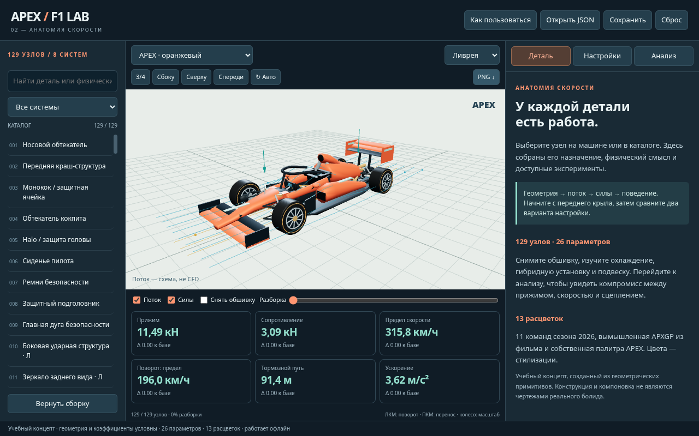

# APEX F1 Atlas

Интерактивный учебный атлас болида «Формулы-1» 
Проект студента группы **Б23-221 Полонского Максима**.

Идея вдохновлена работой над атласом человеческого тела: изучать сложную систему через её устройство, отдельные элементы и их взаимосвязи.

## Открыть сайт

После публикации ссылка на сайт появится в **Settings → Pages** и в окружении **github-pages** этого репозитория. Посетителю достаточно открыть ссылку: скачивать проект, устанавливать Python или запускать сервер не нужно.

Нужен современный браузер с **JavaScript и WebGL 2**. Браузеры или устройства без WebGL 2 не смогут показать 3D-сцену. На телефоне модель управляется жестами, а каталог и карточки расположены под сценой.

## Возможности

- 3D-модель: вращение, масштаб, готовые ракурсы и снимок PNG.
- 129 выбираемых узлов в 8 системах, поиск и подробные описания.
- Разборка, снятие обшивки и изоляция детали.
- 26 параметров, иллюстративный поток и стрелки сил.
- Сравнение конфигураций, графики и экспорт CSV.
- 13 цветовых стилизаций и перенос настроек через JSON.

## Управление

| Действие | Управление |
| --- | --- |
| Вращение | Перетаскивание левой кнопкой / одним пальцем |
| Масштаб | Колесо мыши / жест двумя пальцами |
| Перенос камеры | Правая кнопка мыши / жест двумя пальцами |
| Выбор детали | Щелчок по машине или строке каталога |
| Разборка | Ползунок «Разборка» или E |
| Ракурсы | Кнопки над сценой или клавиши 1–4 |
| Сброс | R |
| Вернуться к сборке | Escape |

